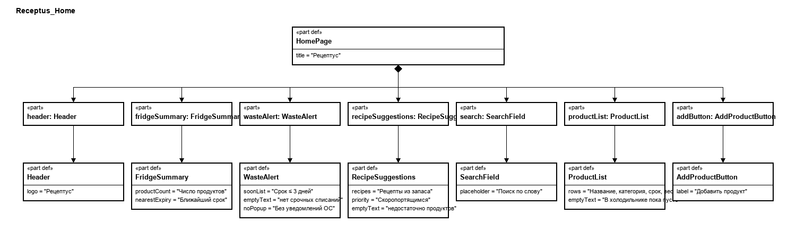
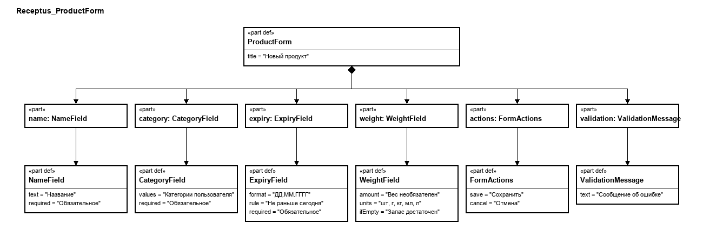

# ОТЧЁТ
по лабораторной работе № 3
на тему «РАЗРАБОТКА И ДОКУМЕНТИРОВАНИЕ БИЗНЕС-ТРЕБОВАНИЙ»

Министерство образования Республики Беларусь 
Учреждение образования «Белорусский государственный университет информатики и радиоэлектроники» 
Факультет компьютерных систем и сетей 
Кафедра электронных вычислительных машин 
Дисциплина: Жизненный цикл разработки программного обеспечения

Студент: К. Д. Усевич, группа 450502 
Преподаватель: Д. В. Куприянова 
Минск 2026

Текст ниже переносится в документ Word по СТП БГУИР. Рисунки берутся из каталога `приложения`.

## 1 ЦЕЛЬ И ЗАДАЧИ

Цель работы — изучить процесс выявления требований к программному обеспечению, освоить методы их структурирования и документирования в спецификации требований (SRS) и получить навык совместной работы над требованиями.

Задачи работы:

1. Выбрать вариант приложения, определить тип проекта, технологический стек, границы продукта и название.
2. Получить бизнес-требования от заказчика, выделить потребности пользователя и составить перечень функций.
3. Описать экраны на языке SysML v2 и сохранить структурные диаграммы в формате PNG.
4. Заполнить шаблон SRS: функциональные и нефункциональные требования, требования к интерфейсам и к защите данных.
5. Зафиксировать материалы в отдельной ветке Git и отправить её в удалённый репозиторий.
6. Разобрать замечания заказчика и преподавателя: принять обоснованные правки и уметь объяснить, почему остальные отклонены.

## 2 КРАТКИЕ ТЕОРЕТИЧЕСКИЕ СВЕДЕНИЯ

### 2.1 Понятие требования и важность раннего этапа

Требование к ПО описывает нужное поведение системы или её свойство, без которого потребность заказчика не закрывается. На раннем этапе ошибка в понимании цели дешевле, чем та же ошибка в уже написанной программе: переделка кода, тестов и данных стоит больше, чем правка абзаца в спецификации. Заказчик распоряжается ограниченными временем, бюджетом и людьми, поэтому в документ попадает только то, что относится к заявленной цели.

### 2.2 Роль коммуникации с заказчиком

В начале работы у заказчика есть проблема, а не перечень полей формы. Задача менеджера — вопросами превратить эту проблему в проверяемые утверждения: кто пользователь, какие данные он вводит, какой результат считает успехом и что в продукт не входит. Пока формулировка допускает два смысла, её уточняют у заказчика, а не додумывают на этапе кодирования.

### 2.3 Прототипирование

Если заказчик видит программу только в готовом виде, расхождение с ожиданием обнаруживается слишком поздно. Макет экрана показывает состав блоков до реализации. В этой работе макет описан текстом SysML v2 (`part def` для блоков экрана) и сохранён картинкой PNG, чтобы заказчик мог подтвердить состав главного экрана и формы продукта.

### 2.4 Управление изменениями требований

Требования меняются, когда заказчик точнее понимает процесс или преподаватель просит поправку на занятии. Изменение вносится в спецификацию, получает новую строку в истории версий и проходит через отдельную ветку. Так видно, какая редакция согласована, и основная ветка не смешивается с черновиком.

## 3 ОПИСАНИЕ ВЫПОЛНЕННОГО ЗАДАНИЯ

### 3.1 Выбор варианта приложения и обоснование технологического стека

Тема, назначенная студенту: агрегатор продуктов — анализ содержимого холодильника и предложение рецептов из имеющихся продуктов с минимизацией пищевых отходов. Продукт назван «Рецептус». Тип проекта — desktop-приложение. Язык реализации — Java, интерфейс предполагается на Swing, сборка — Maven, целевая ОС — Windows.

Границы версии 0.1: один холодильник и один локальный пользователь; название, срок, категория (свои категории), вес необязателен; поиск по названию; стартовые и свои рецепты; срочные продукты только на экране; хранение в локальных файлах без СУБД; работа офлайн. Вне границ: КБЖУ, уведомления ОС, несколько холодильников, авторизация/пароль, заказ в магазине, синонимы, внешние API, ИИ, undo.

Такой стек согласован с языком темы. Сеть и СУБД для учёта домашнего запаса не требуются.

### 3.2 Анализ бизнес-требований и формирование ключевых функций

Требования собраны в роли заказчика и менеджера. Заказчик описал потребность так: продукты в холодильнике портятся незаметно, рецепты из интернета требуют докупки, а из уже купленного часто можно приготовить блюдо и не выбрасывать еду.

Зафиксированные функции:

* список продуктов одного холодильника;
* запись продукта: название, срок, категория; вес необязателен;
* свои категории и свои рецепты;
* поиск по вхождению слова;
* сводка и список продуктов со сроком ≤ 3 дней (без popup ОС);
* подбор рецептов из имеющегося; приоритет скоропортящимся;
* пустые состояния списка и подбора;
* сохранение в локальных файлах.

Отклонённые расширения: несколько холодильников, пароль, заказ в магазине, нейросеть, КБЖУ. Причина — вне границ, согласованных с заказчиком. Замечания через pull request разбираются: конструктивные принимаются, хотелки и мусор отклоняются с причиной.

### 3.3 Разработка графической части документа

Экраны описаны конструкциями `part def` языка SysML v2. Исходный текст лежит в `приложения/home-page.sysml` и `приложения/product-form.sysml`. По этим моделям построены структурные диаграммы и сохранены в PNG.

Главный экран (`HomePage`) содержит блоки `Header`, `FridgeSummary`, `WasteAlert`, `RecipeSuggestions`, `SearchField`, `ProductList` и `AddProductButton`. Диаграмма приведена на рисунке 3.1.

Форма продукта (`ProductForm`) содержит блоки `NameField`, `CategoryField`, `ExpiryField`, `WeightField`, `FormActions` и `ValidationMessage`. Диаграмма приведена на рисунке 3.2.

Полный текст моделей приведён в приложениях А и Б.

### 3.4 Заполнение шаблона спецификации требований

Шаблон `srs/srs-template.md` заполнен и сохранён отдельным файлом `srs/srs.md`, чтобы пустой шаблон остался в репозитории для следующих работ. В документе описаны назначение и границы «Рецептуса», глоссарий, пользователи, ограничения, требования с идентификаторами `REQ-[AREA]-[NNN]`, матрица проверки и ссылки на диаграммы.

Обязательные требования сформулированы со словом «должна». Пример: система подбирает только те рецепты, для которых хватает ингредиентов; при отсутствии подходящих показывает «недостаточно продуктов для рецептов» и не оставляет пустой список без пояснения.

Фрагмент для рисунка 3.3 — начало файла `srs/srs.md` (титул спецификации и история изменений) либо блок `REQ-FUNC-006` в разделе 3.2. В отчёт вставляется снимок этого фрагмента из редактора.

### 3.5 Работа с системой контроля версий

Материалы лабораторной ведутся в репозитории https://github.com/Kristinkus/SDLC.

Порядок действий:

1. От ветки `main` создана ветка `lab3`, чтобы черновик требований не попадал в основную ветку.
2. В ветку добавлены `srs/srs.md`, модели SysML v2 и диаграммы PNG.
3. Ветка отправлена в удалённый репозиторий, оформлен pull request: https://github.com/Kristinkus/SDLC/pull/1
4. Замечания через PR разобраны: конструктивные приняты, остальные отклонены с обоснованием; принятые правки внесены в `srs/srs.md` (версия 0.1).

Ссылка на ветку: https://github.com/Kristinkus/SDLC/tree/lab3

Слияние в `main` выполняется отдельно, после просмотра ветки.

## ЗАКЛЮЧЕНИЕ

В ходе работы по теме «агрегатор продуктов» собран набор бизнес-требований к desktop-приложению «Рецептус». Потребность заказчика переведена в проверяемые требования: учёт холодильника, контроль сроков, подбор рецептов, свои категории и рецепты, поиск, локальные файлы без СУБД. Экраны описаны на SysML v2 и сохранены в PNG. Спецификация записана в `srs/srs.md`, замечания напарника через PR учтены.

## ПРИЛОЖЕНИЕ А
Текст модели главного экрана (приложения/home-page.sysml)

`sysml
package Receptus_Home {
    part def HomePage {
        attribute title = "Рецептус";

        part header : Header;
        part fridgeSummary : FridgeSummary;
        part wasteAlert : WasteAlert;
        part recipeSuggestions : RecipeSuggestions;
        part productList : ProductList;
        part search : SearchField;
        part addButton : AddProductButton;
    }

    part def Header {
        attribute logo = "Рецептус";
    }

    part def FridgeSummary {
        attribute productCount = "Число продуктов в холодильнике";
        attribute nearestExpiry = "Ближайший срок годности";
    }

    part def WasteAlert {
        attribute soonList = "Продукты со сроком ≤ 3 дней (только на экране)";
        attribute emptyText = "нет срочных списаний";
        attribute noPopup = "Без всплывающих уведомлений ОС";
    }

    part def RecipeSuggestions {
        attribute recipes = "Рецепты из имеющихся продуктов";
        attribute priority = "Приоритет скоропортящимся";
        attribute emptyText = "недостаточно продуктов для рецептов";
    }

    part def ProductList {
        attribute rows = "Название, категория, срок, вес (если указан)";
        attribute emptyText = "В холодильнике пока пусто";
    }

    part def SearchField {
        attribute placeholder = "Поиск по вхождению слова";
    }

    part def AddProductButton {
        attribute label = "Добавить продукт";
    }
}
`

## ПРИЛОЖЕНИЕ Б
Текст модели формы продукта (приложения/product-form.sysml)

`sysml
package Receptus_ProductForm {
    part def ProductForm {
        attribute title = "Новый продукт";

        part name : NameField;
        part category : CategoryField;
        part expiry : ExpiryField;
        part weight : WeightField;
        part actions : FormActions;
        part validation : ValidationMessage;
    }

    part def NameField {
        attribute text = "Название продукта";
        attribute required = "Обязательное";
    }

    part def CategoryField {
        attribute values = "Категории пользователя (можно создать свою)";
        attribute required = "Обязательное";
    }

    part def ExpiryField {
        attribute format = "ДД.ММ.ГГГГ";
        attribute rule = "Не раньше сегодняшней даты";
        attribute required = "Обязательное";
    }

    part def WeightField {
        attribute amount = "Вес необязателен";
        attribute units = "Фиксированный список: шт, г, кг, мл, л";
        attribute ifEmpty = "Для рецептов запас считается достаточным";
    }

    part def FormActions {
        attribute save = "Сохранить";
        attribute cancel = "Отмена";
    }

    part def ValidationMessage {
        attribute text = "Сообщение, если поле заполнено неверно";
    }
}
`
